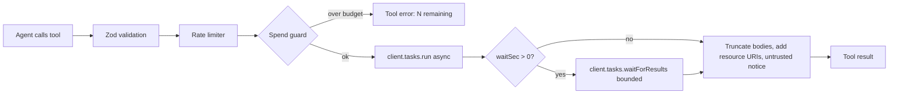

# Architecture

Built (pre-release).

```
src/
  bin.ts              entrypoint: parse env, pick transport, start (wiring only)
  config.ts           env parsing with Zod (pure)
  server.ts           createServer(deps): registers tools and resources on McpServer
  tools/              one file per tool: schema, handler(deps, input), summary
  resources/tasks.ts  resource template handler
  guard/
    spend.ts          per-process submission budget (pure state + clock)
    rate-limiter.ts   token bucket per tool (pattern from mcp-suite)
    cache.ts          small TTL cache for terminal reads (pattern from mcp-suite)
  deps.ts             the Deps interface handlers receive
  log.ts              structured JSON logs to stderr, redacted
  format/
    truncate.ts       body preview and truncation (pure)
    result.ts         tool results: one-line summary + JSON, untrusted-content notice (pure)
    errors.ts         client errors → short, redacted, actionable messages
  transport/
    http.ts           Streamable HTTP (stateless): bearer auth, Origin check, /healthz
```

## Dependency rules

- Tool handlers receive `deps` (`client`, `spend`, `limiter`, `cache`, `now`) and never construct them, so each handler is tested with fakes.
- Only `bin.ts` reads `process.env`. Only `transport/*` touches the network listener.
- All Charted Sea HTTP goes through `charted-sea-client`; no `fetch` in this repo.

## Flow: `run_scraping_tasks`



## HTTP mode

Stateless Streamable HTTP: each request gets a fresh `McpServer` and transport, but all of them share one `Deps`, so the spend guard, rate limiter and read cache are per process, not per request. stdio is wired directly in `bin.ts` with the SDK's `StdioServerTransport`.

## Reused patterns

`~/projects/job_search/mcp-suite/src/shared/`: the token-bucket `RateLimiter` interface (`rate-limiter.ts`), the `Cache` interface (`cache.ts`) and the error classes (`errors.ts`). They're copied and adapted (per-tool buckets, injected clock), not imported, since mcp-suite isn't a published package.
